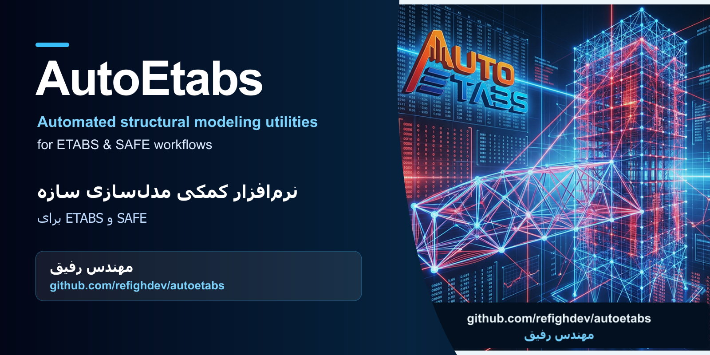

<div align="center">



# AutoEtabs

**Automated structural modeling utilities for ETABS & SAFE workflows**

**نرم‌افزار کمکی مدل‌سازی سازه برای ETABS و SAFE**

Maintainer / نگهدارنده: **مهندس رفیق**  
Repository / مخزن: [github.com/refighdev/autoetabs](https://github.com/refighdev/autoetabs)

</div>

---

## English

### Overview

AutoEtabs is a Windows desktop utility designed to speed up repetitive structural-modeling tasks around CSI ETABS and SAFE. The application provides guided inputs for building geometry and related modeling data, including stories, levels, grid lines and structural components.

### Highlights

- Story, level and grid definition workflows
- Guided structural-model input screens
- Tools for frames, walls, slabs and foundations
- Quantity/reporting utilities
- Persian building-design concepts and terminology
- Portable Windows x64 application layout

### Run

1. Download `AutoEtabs-7.11.6-win-x64.zip` from the repository Releases page.
2. Extract the ZIP file on Windows x64 (this creates the portable `app/` folder).
3. Keep all files together inside the extracted folder — the executable needs its neighboring DLLs.
4. Run `app/Auto ETABS 5.exe` or `app/Run Auto ETABS.bat`.

The portable application itself is published as a Release ZIP asset and is intentionally not stored in Git history (`app/` is git-ignored).

> ETABS/SAFE integration features require the corresponding CSI software/API to be available on the target Windows system.

### Project layout

```text
app/       Portable Windows application (delivered via Release ZIP, not in Git)
assets/    Branding and documentation images
tools/     Maintenance and patching utilities
reports/   Verification summaries
```

### Maintainer

**Engineer Rafiqh — مهندس رفیق**  
[github.com/refighdev/autoetabs](https://github.com/refighdev/autoetabs)

---

## فارسی

### معرفی

AutoEtabs یک نرم‌افزار دسکتاپ ویندوزی برای سرعت‌دادن به کارهای تکراری مدل‌سازی سازه در کنار CSI ETABS و SAFE است. این برنامه ورودی‌های هدایت‌شده‌ای برای هندسهٔ ساختمان و داده‌های مدل‌سازی، از جمله طبقات، ترازها، خطوط شبکه و اجزای سازه‌ای ارائه می‌کند.

### قابلیت‌ها

- تعریف طبقات، ترازها و خطوط شبکه
- صفحه‌های ورودی هدایت‌شده برای مدل سازه‌ای
- ابزارهای مربوط به قاب‌ها، دیوارها، دال‌ها و فونداسیون
- ابزارهای کمکی متره و گزارش‌گیری
- مفاهیم و اصطلاحات فارسی طراحی ساختمان
- ساختار قابل‌حمل برای Windows x64

### اجرا

1. از صفحهٔ Releases همین مخزن، فایل `AutoEtabs-7.11.6-win-x64.zip` را دانلود کنید.
2. فایل ZIP را در Windows x64 استخراج کنید (پوشهٔ قابل‌حمل `app/` ساخته می‌شود).
3. همهٔ فایل‌ها را کنار هم داخل همان پوشه نگه دارید؛ فایل اجرایی به DLLهای کناری‌اش نیاز دارد.
4. فایل `app/Auto ETABS 5.exe` یا `app/Run Auto ETABS.bat` را اجرا کنید.

خود برنامه به‌صورت فایل ZIP در Release منتشر می‌شود و عمداً داخل تاریخچهٔ Git نگه داشته نمی‌شود (`app/` در gitignore است).

> قابلیت‌های ارتباط با ETABS و SAFE به نصب بودن نرم‌افزار و API مربوط CSI روی ویندوز مقصد نیاز دارند.

### ساختار پروژه

```text
app/       برنامهٔ قابل‌حمل ویندوز (از طریق Release ZIP، خارج از Git)
assets/    تصاویر برندینگ و مستندات
tools/     ابزارهای نگهداری و پچ
reports/   خلاصه‌های بررسی و تست
```

### نگهدارنده

**مهندس رفیق**  
[github.com/refighdev/autoetabs](https://github.com/refighdev/autoetabs)
